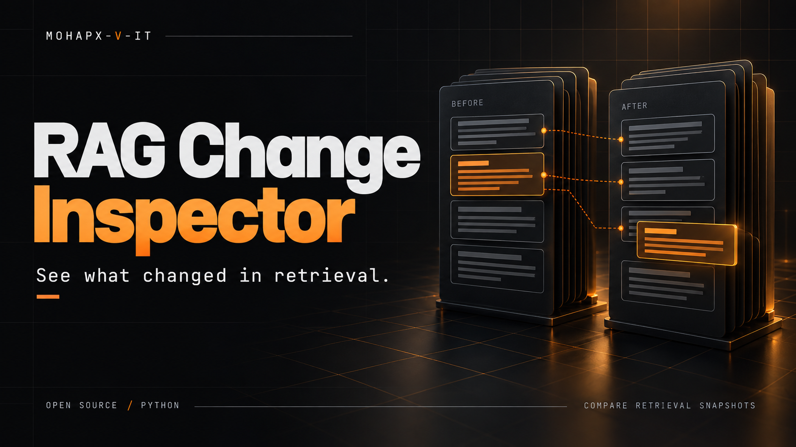

# RAG Change Inspector

**Find the retrieval regressions your average score can hide.**

Compare two search snapshots and see which sources disappeared, moved down the ranking or changed their text. Open one HTML file to investigate; no hosted dashboard needed.

[Quick start](#quick-start) · [Snapshot format & adapters](docs/usage.md) · [Русский](README.ru.md) · [MIT](LICENSE)

- **Measure four ways.** Recall@K, MRR@K, source-aware Precision@K and NDCG@K.
- **Inspect the evidence.** Before/after fragments, rank moves, lost sources and changed chunks.
- **Catch individual regressions.** Optional per-question CI gate.
- **Stay portable.** JSON snapshots, an optional Chroma adapter and an offline report.

## Quick start

Python 3.11+. Run from the cloned repository; no runtime dependencies required.

```shell
python -m rag_change_inspector init rag-demo
python -m rag_change_inspector compare rag-demo/before.json rag-demo/after.json --k 1 --html reports/diff.html
```

Open `reports/diff.html`. The example deliberately returns exit code **1** because a relevant source dropped out of top-1.

## Make it a release check

```shell
python -m rag_change_inspector compare before.json after.json --k 5 --max-drop 0.02 --fail-on-question --json reports/diff.json --html reports/diff.html
```

Search questions and fragments in the report, enable **Regressions only**, then expand a question to inspect both rankings.

| Exit code | Meaning |
|---|---|
| `0` | Comparison passes |
| `1` | Regression beyond threshold or missing questions |
| `2` | Invalid input or no common labelled questions |

**Scope:** binary source relevance over ranked chunks. Stable question/source IDs and identical ground truth are required. The report shows changes, not proven causes. Querying Chroma with text can invoke its configured embedding provider; comparing saved snapshots stays offline.

Built by [Aleksei Maryshev / MOHAPX-V-IT](https://mohapx-v-it.github.io/mohapx-v-iti/). MIT licensed. Early release; APIs may change.
